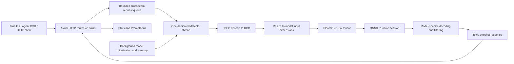

# Blue Onyx: source analysis and fork roadmap

Analysis date: 13 October 2026. Baseline: upstream `main` at
[`1cd4d93d95b99a4456b7c856c94fb5654c908ad2`](https://github.com/xnorpx/blue-onyx/commit/1cd4d93d95b99a4456b7c856c94fb5654c908ad2).
Primary target: Linux x86_64, Docker, and Intel integrated/discrete GPUs through OpenVINO, while preserving the Blue Iris / Agent DVR HTTP contract. NVIDIA CUDA is an optional secondary build.

## Conclusion

Keep the Rust service and ONNX abstraction. The project is small enough to maintain incrementally; a rewrite would discard useful compatibility and native inference code. Its strongest immediate opportunities are dependable containers, request scheduling, model management, and hardware validation.

The available history does **not** establish abandonment. There are human-authored platform and model-download changes in August 2026 and dependency updates in September 2026. The fork can have its own release cadence without making claims about upstream's future intentions.

This document separates observed source behavior, implemented fixes, and work still requiring validation. It is an architecture and maintenance assessment, not a complete security audit or accuracy benchmark.

## Runtime architecture

The normal CLI uses a **single-thread Tokio runtime** for HTTP. One native detector thread owns the ONNX session and mutable image/tensor buffers. Concurrent camera requests queue behind serial inference. This avoids sharing the session across requests, but blocking a queue send in an HTTP handler can stall the entire HTTP runtime.

Initialization runs in a separate thread. The server opens before model download/session creation finishes; HTTP liveness therefore differs from detector readiness. Each process hosts one model. Multiple models require multiple processes and ports; `/v1/vision/custom/list` currently returns an empty list.

## Source map

| File | Responsibility |
| --- | --- |
| `src/bin/blue_onyx.rs` | CLI, Tokio runtime, signal handling, restart loop |
| `src/lib.rs` | Service wiring, logging, model resolution, embedded fixtures |
| `src/cli.rs` | Clap arguments, JSON config, merge/save behavior |
| `src/startup_coordinator.rs` | Background initialization and handover |
| `src/server.rs` | HTTP routes, readiness, enqueue/wait, forms, metrics |
| `src/worker.rs` | Queue sizing and serial inference loop |
| `src/detector.rs` | ONNX provider/session setup, tensor transforms, postprocessing |
| `src/image.rs` | JPEG decoding, resizing, annotations, file output |
| `src/download_models.rs` | Hugging Face catalog and downloads |
| `build.rs` | Runtime source builds or prebuilt-library staging |
| `templates/` | Askama pages and Prometheus exposition |
| `src/bin/blue_onyx_benchmark.rs` | Local detector benchmarking |
| `src/bin/test_blue_onyx.rs` | HTTP load/client utility |
| `src/bin/blue_onyx_service.rs` | Windows Service integration |

## Compatibility surface

The actual detection endpoint is `POST /v1/vision/detection`, using multipart fields `image` and optional `min_confidence`. Inputs are JPEGs. URL-based image fetching and JSON detection requests are not implemented. The baseline README's `/detect` examples were incorrect and have been corrected in this fork.

Prediction fields retain `label`, `confidence`, `x_min`, `x_max`, `y_min`, `y_max`. Response fields retain `success`, `error`, `predictions`, `count`, `command`, `moduleId`, `executionProvider`, `canUseGPU`, `inferenceMs`, `processMs`, and `analysisRoundTripMs`.

| Endpoint | Behavior |
| --- | --- |
| `POST /v1/vision/detection` | Detect JPEG objects; compatible JSON |
| `POST /v1/vision/custom/list` | Empty custom-model list |
| `GET /v1/status/updateavailable` | Retrieves upstream release metadata; still upstream-specific |
| `GET /`, `/stats` | Embedded web pages |
| `GET /prometheus` | Metrics |
| `GET/POST /test` | Test form and annotated JPEG output |
| `GET/POST /config` | Read/save server configuration |
| `POST /config/restart`, `/config/loglevel` | Runtime administration |
| `GET /health/live`, `/health/ready` | Added liveness/readiness checks |

The detection JSON shape remains stable. HTTP failures now distinguish invalid input (400), unavailable/full worker (503), and exceeded request deadlines (504). Real-client regression with Blue Iris and Agent DVR remains required before calling this a drop-in release; unit checks alone cannot establish client retry behavior.

## Model pipeline

JPEG pixels are decoded with zune-jpeg, resized with fast_image_resize, and copied into a float32 `[1,3,height,width]` buffer with channels divided by 255. The current path stretches images to model dimensions, rather than applying a universal letterbox transform. ONNX export conventions therefore matter.

| Model adapter | Inputs | Outputs / decoding |
| --- | --- | --- |
| RF-DETR (actual default: `rf-detr-n.onnx`) | `input` | `dets` normalized center/size boxes; `labels` logits; sigmoid, top 300 scores |
| RT-DETR v2 | `images`, `orig_target_sizes` | `labels`, `boxes`, `scores`; coordinate rescaling |
| YOLO5 | `images` | First tensor; objectness, class selection, center/size boxes; class-aware NMS |

Model class metadata uses YAML `NAMES`. Custom export filenames, tensor types, dimensions, class ordering, and normalization must match the selected adapter. Choosing a different ONNX file does not automatically select its adapter. The matching `--object-detection-model-type` is required.

One notable accuracy issue remains: YOLO5 currently reports and thresholds objectness alone, rather than objectness multiplied by class probability. Verify the intended export format, add synthetic tensor fixtures, and correct confidence semantics before changing user thresholds. RF-DETR and RT-DETR outputs also need shape/class-index validation and box clamping before indexing.

## Hardware and build behavior

The Rust `ort` binding is `2.0.0-rc.13`, with `api-28`. The configured native runtime is ONNX Runtime 1.29.0. Rust bindings, native ABI, execution-provider libraries, CUDA/cuDNN, and model export versions must be maintained together.

| Platform / build | Provider |
| --- | --- |
| Linux default | CPU |
| Linux `--features openvino` | Intel OpenVINO GPU, FP16, compiled-model cache |
| Linux `--features cuda` (added) | NVIDIA CUDA; provider registration errors fail initialization |
| Windows | DirectML or CPU |
| macOS | CoreML or CPU |

CUDA and OpenVINO are separate build features and intentionally cannot be enabled together. `--force-cpu` bypasses the GPU provider. A configured GPU provider can still delegate unsupported graph nodes to CPU; a provider label is not evidence that every operator executes on GPU.

The upstream CUDA experiment exists at `564a2c239a10853f30218566cfe317f6a2e5afa2` (an unmerged branch in the fetched history). This fork adapts the concept to the current binding API, uses an explicit feature, requires matching prebuilt libraries, and surfaces provider-registration failures instead of silently labelling CPU fallback as CUDA.

CPU/CUDA Docker builds use official, checksum-verified ONNX Runtime archives. The CUDA 12 archive is paired with a CUDA 12.9/cuDNN 9 runtime image. [ONNX Runtime's compatibility table](https://onnxruntime.ai/docs/execution-providers/CUDA-ExecutionProvider.html) documents CUDA >=12.8 and cuDNN 9 for the 1.29 CUDA 12 package. The existing OpenVINO image still compiles its provider from source.

## Findings and disposition

| Priority | Baseline evidence / consequence | This fork |
| --- | --- | --- |
| High | `/test` calls blocking `Sender::send` on a bounded queue; a full queue can stall HTTP | Shared non-blocking `try_send` path for API and test UI |
| High | HTTP waits 30 seconds irrespective of `request_timeout`; worker merely warns after expiration | Configured remaining deadline; discard expired/cancelled queued work before inference |
| High | CLI selects restart/shutdown by dropping the service future; only Ctrl+C is handled | Await graceful server drain, release queue sender, join worker; Unix SIGTERM supported |
| High | Custom `--model` directory is discarded before resolution | Preserve existing paths; explicit missing custom paths fail clearly |
| High | Config/model writes are beside the executable; OpenVINO mounts do not redirect them | Explicit config/model environment paths and persistent volumes |
| High | General Dockerfile requires prebuilt binaries; publish workflow copies nonexistent `/tmp/models` | Source-built CPU/CUDA containers; publish exact released source only |
| Medium | No detector readiness endpoint; Compose healthcheck disabled | Liveness/readiness routes and container readiness probes |
| Medium | Queue estimate divides integer milliseconds; sub-ms inference divides by zero and slow inference yields zero capacity | Nanosecond estimate, automatic queue clamped to 1–64 |
| Medium | Invalid confidence/deadline/queue/GPU-index settings can persist | Config validation and request-confidence validation |
| Medium | Unknown-route handler reads body with `usize::MAX` | Limit fallback body to 30 MiB |
| Medium | Built-in model YAML overrides explicit `--object-classes` | Explicit class file takes precedence; custom model can use it without a sidecar |
| Medium | CI mostly builds, has write permissions, and creates development releases | Read-only test/lint CI, CUDA compile checks, CPU container smoke job |
| Medium | YOLO confidence uses objectness alone | Open accuracy work; fixture-driven change required |
| Medium | Output-name indexing and assumptions can panic for incompatible custom models | Open robustness work |
| Medium | JSON/CLI merge infers explicit CLI overrides by comparing against defaults | Open: use Clap `ValueSource` so explicit default-valued arguments can override config |
| Medium | Config reads/writes are synchronous, non-atomic; multipart errors can be ignored in config handlers | Open: atomic persistence and explicit form validation |
| Medium | Admin routes have no auth and server listens on all interfaces | Compose binds loopback by default; authenticated remote administration remains open |
| Medium | Prometheus initial min/max values are integer sentinels; labels use HTML template escaping | Open: dedicated Prometheus encoding and histogram/queue metrics |
| Medium | Update checking and installer links are hardcoded to upstream | Open release migration; do not publish a fork release until addressed |
| Medium | Models resolve from mutable Hugging Face branches; bulk downloads can return success after individual failures | Open: pinned revisions, digests, required-file errors, offline operation |

Deadlines do not interrupt an ONNX call already in progress. Dropping stale jobs prevents additional work; a hung native inference call can still exceed container shutdown grace and require termination. Initialization threads similarly are not forcibly cancelled during model download; process exit remains the ultimate boundary.

## Validation performed

- Baseline `cargo test --locked --lib`: 5 passed, on Apple Silicon.
- Fork `cargo test --locked --all-targets`: 13 passed.
- `cargo clippy --locked --all-targets -- -D warnings`: passed.
- Rust formatting and `git diff --check`: passed.
- Compiled service smoke: default RF-DETR model downloaded, CPU inference returned bicycle/car/dog, readiness succeeded, SIGTERM exited with code 0.
- ONNX Runtime used for the local smoke: official macOS arm64 1.29.0 binary.
- [Initial fork CI run](https://github.com/lowfoon/blue-onyx/actions/runs/38371794404): Linux, Windows and macOS all-target tests/lints passed; Linux CUDA tests/lints passed; CPU Docker source build, liveness, readiness failure, and SIGTERM lifecycle smoke passed.
- [Intel-focused validation run](https://github.com/lowfoon/blue-onyx/actions/runs/38373206951) at `89f41c2`: all seven jobs passed, including Linux/Windows/macOS tests and lints, CUDA tests/lints, and CPU/CUDA/Intel OpenVINO source-built containers with liveness/readiness-failure and SIGTERM lifecycle checks. Later commits update release metadata and documentation without changing the validated Rust source or container build instructions.
- Container packaging retains the service MIT license and ONNX Runtime license/notices.

The local host has no Docker CLI and no Linux GPU test environment attached to this checkout. Linux and Windows compilation/tests were validated by CI, and the initial CPU container lifecycle smoke passed there. Actual CUDA/OpenVINO GPU inference, real camera concurrency, and Windows NVR integration remain unvalidated. CI now also builds the Intel OpenVINO and NVIDIA CUDA containers and checks their lifecycle without requiring a GPU; hardware acceptance is a separate gate.

## Roadmap and release gates

1. **First Linux release:** run the new CI; build CPU, CUDA, and OpenVINO images; test each against its hardware. Capture actual provider registration, GPU utilization, idle/burst memory, cold start, p50/p95/p99 latency, and dropped requests. Verify Blue Iris and Agent DVR behavior with 400/503/504 responses. Configure fork release metadata and model licensing records.
2. **Accuracy and model contracts:** extract postprocessors into tensor-only functions; add expected-output fixtures for all three adapters; fix YOLO confidence; validate output names/shapes and clamp boxes. Create a representative labelled day/night camera dataset. Compare precision/recall and latency before changing defaults.
3. **Operations:** atomic config updates; correct explicit CLI override semantics; model revision/digest manifests; actionable readiness details; queue-depth gauges and latency histograms; log rotation and configurable bind address; authenticated administration suitable for remote deployments.
4. **Throughput:** measure the existing single-worker design before adding batching, worker pools, TensorRT, or multi-model routing. Bound queues by measured service time and memory, not just fastest warmup. Prefer architectural changes supported by multi-camera measurements.

Keep original attribution and `LICENSE`. Record third-party runtime/provider notices and model/font/image licenses separately; the service's MIT license is not a blanket license for downloaded weights or bundled assets.
